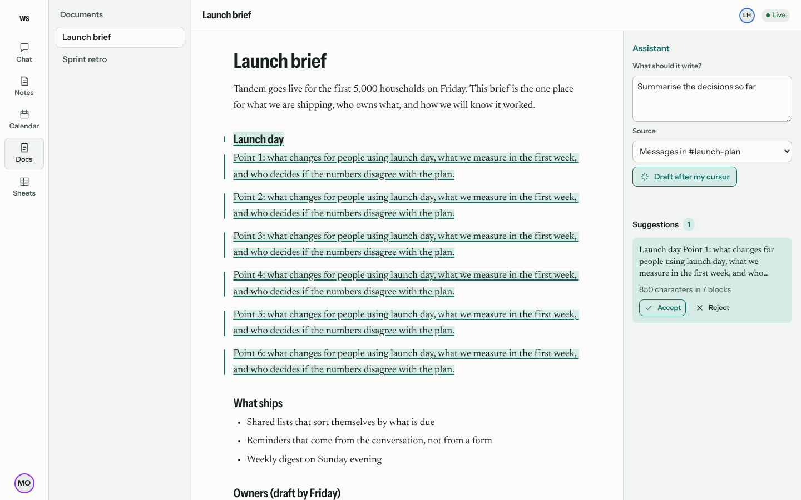
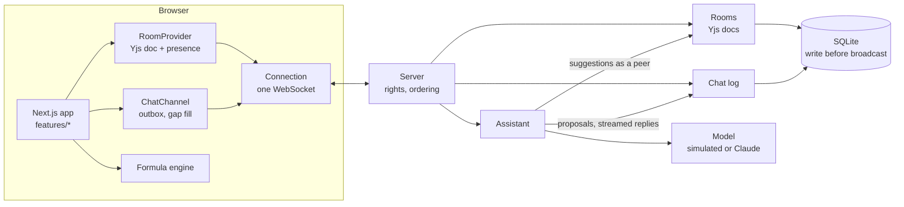
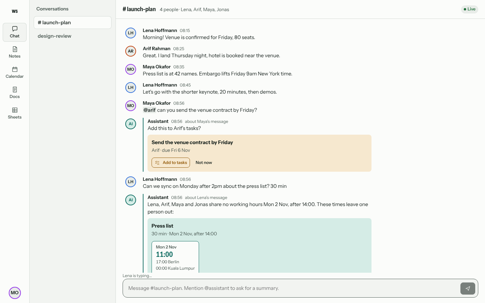
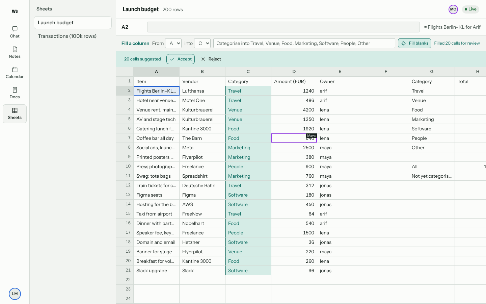
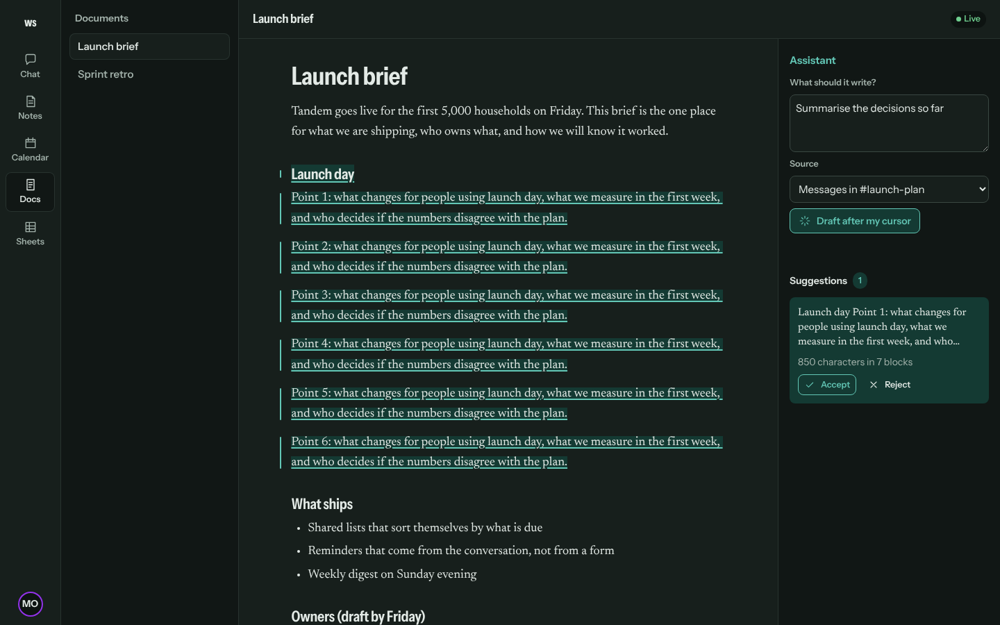
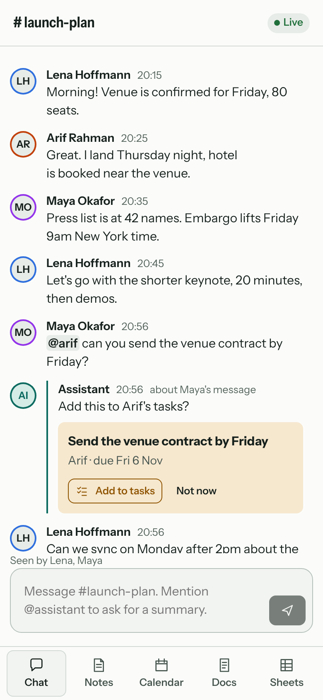

# agent-native-workspace

Chat, Notes, Calendar, Docs and Sheets on **one real-time sync engine**, with an assistant that works
inside each of them instead of in a chatbot on the side:

- it **notices** a meeting or a request in a message and offers it right under that message, with
  times that work in everyone's own time zone;
- it **writes into a shared document as a collaborator**, with its own caret, while people keep typing;
  what it writes is a tracked suggestion until someone accepts it;
- it **fills a spreadsheet column** as pending cells that recalculate the totals live;
- it **finds appointments in your notes** ("Dentist Tue 10am") and books them when you say so.

The hard part of an AI-native productivity app is not calling a model. It is keeping several people,
several devices and an agent editing the same things at once, over bad networks, without anyone losing
words, seeing a message twice, or having the assistant act without asking. That is what this repository
builds and tests.



## What is in it

| Surface            | What happens                                                                                                                                                                                                                                          | Built with                                                             |
| ------------------ | ----------------------------------------------------------------------------------------------------------------------------------------------------------------------------------------------------------------------------------------------------- | ---------------------------------------------------------------------- |
| **Sync engine**    | One WebSocket per client carries every room (Yjs sync and presence), the chat log and agent runs. Reconnects with backoff and jitter, detects dead links with a heartbeat, times out hung handshakes, compresses frames.                              | `packages/sync`, `apps/server`                                         |
| **Chat**           | The server alone orders messages; sends are idempotent, so a message is shown once however often the network drops. An outbox survives reloads. Typing, read receipts, edits, deletes, streamed replies that resume after a reconnect.                | `features/chat`                                                        |
| **Docs and Notes** | Tiptap 3 on Yjs. The assistant is a server-side peer that streams a draft as new blocks after your cursor, anchored with Yjs relative positions. People's typing never carries the assistant's mark. Undo covers only your own edits.                 | `features/docs`, `features/notes`, `packages/agent/src/suggestions.ts` |
| **Calendar**       | Week view in any team member's time zone, drag or Alt+arrow to move, overlapping events side by side, tasks on their due day.                                                                                                                         | `features/calendar`                                                    |
| **Sheets**         | A formula engine (SUM, SUMIF, VLOOKUP, IF, IFERROR…) that recalculates only what an edit reaches, with cycle detection; a grid virtualised in both directions that scrolls 100,000 rows; keyboard navigation, copy and paste, other people's cursors. | `packages/sheets`, `features/sheets`                                   |
| **Assistant**      | Reads intent from chat in English and German; a scheduler picks slots inside every attendee's working hours, daylight-saving aware, and says who is left out when three time zones share no hours. Re-checks the calendar before booking.             | `packages/agent`, `apps/server/src/assistant.ts`                       |

**Models write, code decides.** The model (a deterministic simulated model by default, Claude with
`ANW_MODEL=claude`) produces text. Who is asked, when a meeting can be, who may book it, which cells may
be filled and what counts as accepted are decided by code, and every one of those decisions has a test.

## Results

All numbers are produced by the tests in this repository.

| Check                                                                                  | Result                                                                                                       |
| -------------------------------------------------------------------------------------- | ------------------------------------------------------------------------------------------------------------ |
| Unit, property and integration tests                                                   | **89 passing** (sheets 28, agent 29, server 17, web 10, sync 5)                                              |
| End-to-end in Chromium (two people, offline, booking, streaming, rights, axe, budgets) | **15 passing**                                                                                               |
| Chaos: random latency on every frame, dropped connections, a server restart mid-run    | all replicas identical; every chat message exactly once, in one order, each sender's in send order (4 seeds) |
| Incremental recalculation equals recomputing from scratch                              | 400 random edit sequences with cycles, ranges and errors                                                     |
| Assistant text and people's text under any interleaving of edits and delivery          | 300 random interleavings: every character people typed survives, the assistant's text stays in order         |
| Typing while the assistant streams into the same document (p95 key event)              | **48 ms quiet → 64 ms during a stream** (budget: quiet + 32 ms)                                              |
| Scrolling a 100,000-row sheet (p95 frame)                                              | **24.7 ms** (budget 34 ms); load and compute 7.6 s                                                           |
| Accessibility (axe, WCAG 2.2 AA)                                                       | no serious or critical violations on any screen                                                              |

Measured on a 2-core cloud container in headless Chromium (`reports/perf.json`); budgets are in
`config/perf.json` and CI fails above them.

### What the tests caught

- **A hung handshake** left a client "connecting" forever when the server restarted mid-upgrade
  (WebSockets never time out). Found by the chaos suite; fixed with a connect timeout.
- **Suggestion marks would have silently disappeared** the first time someone typed near them: declaring
  the mark as overlapping made the Yjs binding store it under a hashed key. Found by the editor test.
- **Offline messages did not show** because the outbox array was mutated in place and the React Compiler
  saw no change. Found end-to-end; snapshots are now immutable and unit-tested.
- **Typing slowed to a 288 ms p95** while the assistant streamed, because the review panel recomputed the
  whole document on every update. Throttled derivation, presence that only re-renders when it changes,
  and a measured 120 ms stream flush brought it within budget.

### The blind check, and what it says

Someone who had not seen the code wrote 60 chat messages (21 in German) from
[`heldout/WRITING_MESSAGES.md`](heldout/WRITING_MESSAGES.md) alone, with what a person would expect the
assistant to offer. The set was run once; the result is pinned in
[`reports/heldout/messages-1/first_run.json`](reports/heldout/messages-1/first_run.json).

|                                                               | Result                  |
| ------------------------------------------------------------- | ----------------------- |
| Right call (meeting, task or nothing)                         | 40 of 60                |
| Offers made that were right                                   | **22 of 24 (92%)**      |
| Offers it should have made but did not                        | 18 of 40 (it found 55%) |
| Interruptions on messages that needed nothing                 | 2 of 20                 |
| Day, time, duration, assignee and due date, when it did offer | 40 of 45                |

It is careful rather than complete: when it speaks up it is almost always right, but it misses about
half of the meetings and tasks real people write. For an assistant that interrupts conversations that is
the safer failure, but it is not good enough. The next step is a model that reads the message into the
same structured intent, behind the same decision code, measured on a new blind set. The set above is not
studied, so it stays a fair test.

## Run it

```bash
npm install
npm run dev                      # server on :4417 (demo sign-in), app on :3417
open http://localhost:3417       # pick a person; open a second window as someone else
```

```bash
npx vitest run                   # unit, property, integration and chaos tests (~1 min)
npm -w @anw/web run build && npm run e2e   # Playwright: collaboration, a11y, performance budgets
npm run heldout -- messages-1    # the blind set (writes latest.json; the first run is never rewritten)
ANW_MODEL=claude ANTHROPIC_API_KEY=... npm run dev   # stream from Claude instead of the simulated model
```

Two windows side by side: send "Can we have a call on Wednesday after 3pm about onboarding?" in
_design-review_, or open _Launch brief_ and press **Draft after my cursor** while typing in the other
window, or fill the _Category_ column of _Launch budget_.

## How it fits together



Decisions worth knowing:

- **CRDT for documents, server order for chat.** Documents merge (Yjs); chat needs one order everyone
  agrees on, so the server assigns it and clients dedupe by their own message id.
- **The assistant is a peer, not a writer of final text.** It edits the server's copy of the document
  with its own presence, so it works when nobody has the document open, and everything it writes is a
  suggestion with an author.
- **Human edits win.** If someone deletes or accepts text the assistant is still writing, it stops.
- **Every client computes sheet values itself** from shared inputs; only inputs travel.
- **Feature-first frontend**, design tokens in CSS custom properties (light and dark), motion only where
  something changed (a proposal settling, an accepted suggestion drying from wash to ink), reduced motion
  respected, and loading, error and empty states on every screen.

Stack: TypeScript 7 (native compiler), React 19 with the React Compiler, Next.js 16, Tiptap 3, Yjs,
TanStack Virtual, motion, Temporal (polyfill), Hono and `ws` on Node 22 with `node:sqlite`, zod, Vitest 5,
fast-check, Playwright with axe, Biome.

| Light, chat                        | Sheets with pending suggestions      | Dark, phone                                                                      |
| ---------------------------------- | ------------------------------------ | -------------------------------------------------------------------------------- |
|  |  |   |

## Limits

- **The assistant's intent reading is rules**, English and German, and the blind check shows it misses
  about half of real requests. Its drafts come from a simulated model unless Claude is configured.
- **One server process.** Rooms live in one process; scaling out needs sticky routing by room or a shared
  update bus. Presence is per process.
- **Chat history loads whole** on first open; long channels need paging from the end.
- **The calendar has no recurring events**, and the scheduler knows working hours and busy times, not
  preferences.
- **Sign-in is a demo**: tokens are real (signed, expiring), people are fixed in `config/workspace.json`.
- Performance numbers come from a 2-core container in headless Chromium, not from user devices.
